# FLOW.md
# FINORA — Application User Flow & System Flow

**Versi:** 1.0  
**Status:** Draft implementasi  
**Dokumen acuan:** `PRD.md` — Finora Smart Personal Finance Management  
**Tujuan:** Menjelaskan alur pengguna, alur sistem, aturan bisnis, dan interaksi antarmodul Finora.

---

## 1. Gambaran Umum

Finora merupakan aplikasi pengelolaan keuangan pribadi yang menggabungkan pencatatan manual, pengelolaan akun, transaksi, tabungan, anggaran, analisis, laporan, dan AI Financial Assistant.

Prinsip alur:
1. Pengguna memasukkan atau mengimpor data keuangan.
2. Backend memvalidasi dan menyimpan data.
3. Finance Engine memperbarui saldo dan metrik keuangan.
4. Dashboard, anggaran, tabungan, dan laporan membaca data yang sudah diproses.
5. AI menggunakan metrik terverifikasi untuk membuat penjelasan dan rekomendasi.
6. Integrasi bank/e-wallet menambahkan data melalui koneksi resmi dan persetujuan pengguna.

**Catatan:** Integrasi bank/e-wallet dan AI lanjutan merupakan fase setelah fondasi pencatatan manual stabil. Alur manual harus tetap berfungsi tanpa layanan eksternal.

---

## 2. Peta Navigasi Aplikasi

```text
FINORA
├── Public
│   ├── Landing Page
│   ├── Register
│   ├── Login
│   ├── Forgot Password
│   └── Privacy Policy / Terms
│
└── User Application
    ├── Onboarding
    ├── Dashboard
    ├── Transactions
    │   ├── Transaction List
    │   ├── Add Transaction
    │   ├── Edit Transaction
    │   ├── Transaction Detail
    │   ├── Transfer
    │   └── Import Transactions
    ├── Accounts & Connections
    │   ├── Account List
    │   ├── Add Manual Account
    │   ├── Account Detail
    │   ├── Reconciliation
    │   └── Bank / E-wallet Connections
    ├── Savings Goals
    │   ├── Goal List
    │   ├── Create Goal
    │   └── Goal Detail
    ├── Budget Planner
    │   ├── Budget Overview
    │   ├── Create / Edit Budget
    │   └── Budget Detail
    ├── Financial Analysis
    ├── AI Financial Assistant
    ├── Reports
    ├── Financial Education
    ├── Notifications
    └── Settings
        ├── Profile
        ├── Preferences
        ├── Privacy & AI Permissions
        ├── Security & Sessions
        ├── Connected Services
        ├── Export Data
        └── Delete Account
```

---

## 3. Alur Registrasi, Login, dan Onboarding

### 3.1 Registrasi

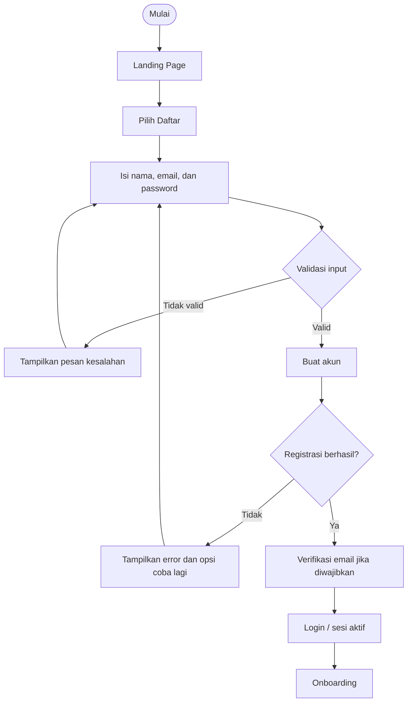

### 3.2 Login

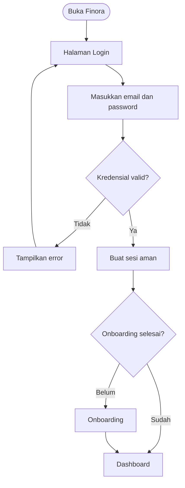

### 3.3 Onboarding

Langkah onboarding:
1. Sambutan dan penjelasan singkat Finora.
2. Pilih mata uang utama (default IDR).
3. Pilih zona waktu (default Asia/Jakarta, dapat diubah).
4. Buat akun keuangan pertama atau lewati.
5. Jika membuat akun, masukkan nama, jenis akun, dan saldo awal.
6. Tampilkan panduan menambahkan transaksi pertama.
7. Masuk ke dashboard.

Aturan:
- Pengguna boleh melewati pembuatan akun saat onboarding.
- Jangan memaksa pengguna menghubungkan bank/e-wallet.
- Jangan meminta kredensial bank.
- Preferensi dapat diubah dari Settings.

---

## 4. Alur Dashboard

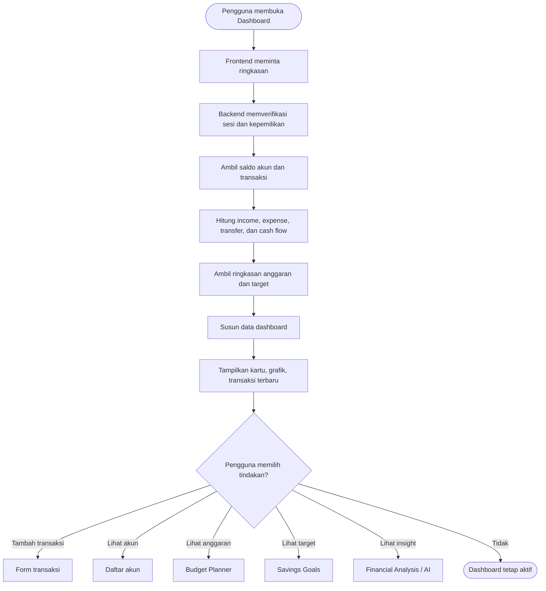

### 4.1 Isi Dashboard

- Total saldo akun yang disertakan.
- Pemasukan periode terpilih.
- Pengeluaran periode terpilih.
- Arus kas bersih.
- Grafik pemasukan dan pengeluaran.
- Pengeluaran per kategori.
- Anggaran dan progres.
- Target tabungan dan progres.
- Transaksi terbaru.
- Insight atau peringatan.

### 4.2 Interaksi Filter

1. Pengguna memilih rentang tanggal.
2. Pengguna opsional memilih satu atau beberapa akun.
3. Frontend mengirim filter ke backend.
4. Backend menghitung ulang agregasi sesuai filter.
5. Dashboard memperbarui semua komponen terkait.
6. Label periode dan filter aktif harus terlihat.

### 4.3 Kondisi Kosong

Jika belum ada akun atau transaksi:
- Tampilkan penjelasan singkat.
- Sediakan tombol buat akun atau catat transaksi.
- Jangan tampilkan angka contoh seolah-olah data pengguna.
- Grafik kosong harus memiliki empty state yang informatif.

---

## 5. Alur Akun dan Rekening

### 5.1 Membuat Akun Manual

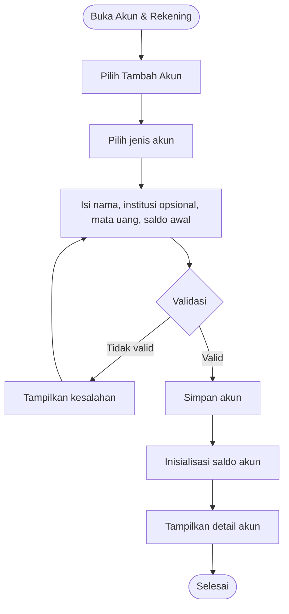

Jenis akun:
- Bank.
- E-wallet.
- Tunai.
- Tabungan.
- Lainnya.

### 5.2 Detail Akun

Pengguna dapat:
- Melihat saldo dan riwayat transaksi.
- Mengubah nama tampilan.
- Mengubah pengaturan akun.
- Melakukan rekonsiliasi.
- Mengarsipkan akun.
- Memulai koneksi penyedia jika tersedia.

### 5.3 Rekonsiliasi Saldo

1. Pengguna membuka detail akun.
2. Memilih Rekonsiliasi Saldo.
3. Memasukkan saldo aktual yang terlihat di sumber resmi.
4. Sistem membandingkan saldo aktual dengan saldo hasil ledger.
5. Jika sama, tandai rekonsiliasi berhasil.
6. Jika berbeda, tampilkan selisih.
7. Pengguna meninjau transaksi yang hilang/keliru atau membuat penyesuaian dengan alasan.
8. Backend menyimpan penyesuaian dan audit log.

Jangan mengubah saldo secara diam-diam. Setiap penyesuaian harus dapat ditelusuri.

---

## 6. Alur Transaksi

### 6.1 Membuat Pemasukan atau Pengeluaran

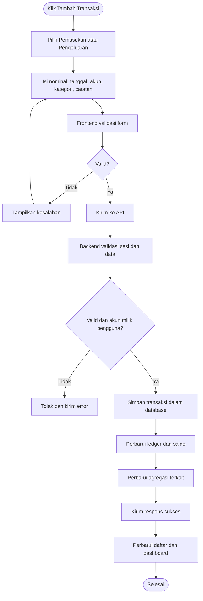

### 6.2 Membuat Transfer Antar-Akun

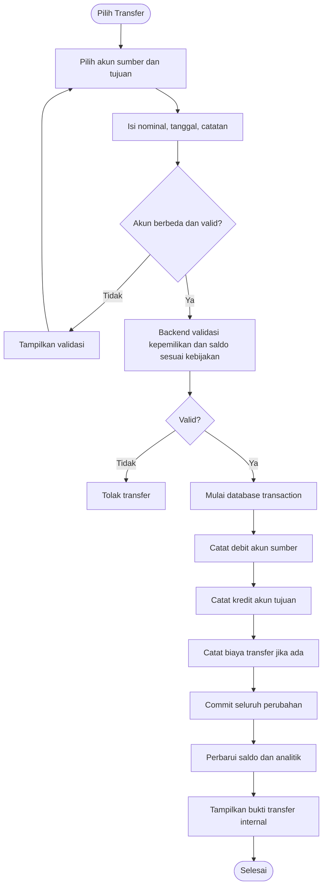

Aturan transfer:
- Akun sumber dan tujuan harus berbeda.
- Kedua akun harus dimiliki pengguna yang sama.
- Debit dan kredit transfer harus tersimpan secara atomik.
- Transfer tidak dihitung sebagai pemasukan atau pengeluaran.
- Biaya transfer adalah expense terpisah.
- Jika salah satu proses gagal, seluruh operasi transfer harus rollback.
- Kebijakan saldo negatif harus ditentukan secara eksplisit di tingkat produk.

### 6.3 Mengubah atau Menghapus Transaksi

1. Pengguna membuka detail transaksi.
2. Memilih edit atau hapus.
3. Backend memverifikasi pemilik transaksi.
4. Untuk edit, backend menghitung dampak perubahan terhadap ledger.
5. Untuk hapus, backend menerapkan kebijakan penghapusan/void yang konsisten.
6. Saldo dan agregasi diperbarui.
7. Audit log dibuat untuk tindakan penting.
8. UI menampilkan hasil.

Transaksi terintegrasi yang dihapus pengguna perlu memiliki kebijakan sinkronisasi agar transaksi tidak muncul kembali tanpa penjelasan.

### 6.4 Transaksi Berulang

1. Pengguna membuat template transaksi.
2. Memilih frekuensi: harian, mingguan, bulanan, atau interval yang didukung.
3. Menentukan tanggal mulai dan akhir bila ada.
4. Worker memeriksa jadwal.
5. Sistem membuat transaksi sesuai jadwal dengan idempotency key.
6. Pengguna mendapat notifikasi bila diaktifkan.
7. Pengguna dapat menjeda, mengubah, atau mengakhiri jadwal.

Untuk MVP, transaksi berulang dapat dibuat sebagai pengingat atau transaksi terjadwal yang memerlukan konfirmasi. Jangan mengasumsikan transaksi bank benar-benar terjadi.

---

## 7. Alur Impor Mutasi CSV/XLSX

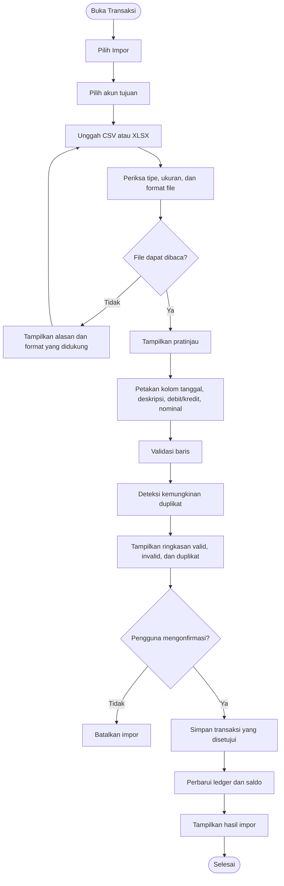

Aturan:
- File tidak langsung diimpor tanpa pratinjau.
- Baris invalid ditandai dan dijelaskan.
- Duplikasi diperiksa berdasarkan akun, tanggal, nominal, deskripsi, dan referensi bila tersedia.
- Pengguna dapat memilih apakah baris duplikat dilewati atau ditinjau.
- File sementara dihapus sesuai kebijakan retensi.
- Jangan menjalankan formula spreadsheet atau macro dari file unggahan.
- Batasi ukuran file dan validasi tipe konten.

---

## 8. Alur Tabungan dan Target Keuangan

### 8.1 Membuat Target

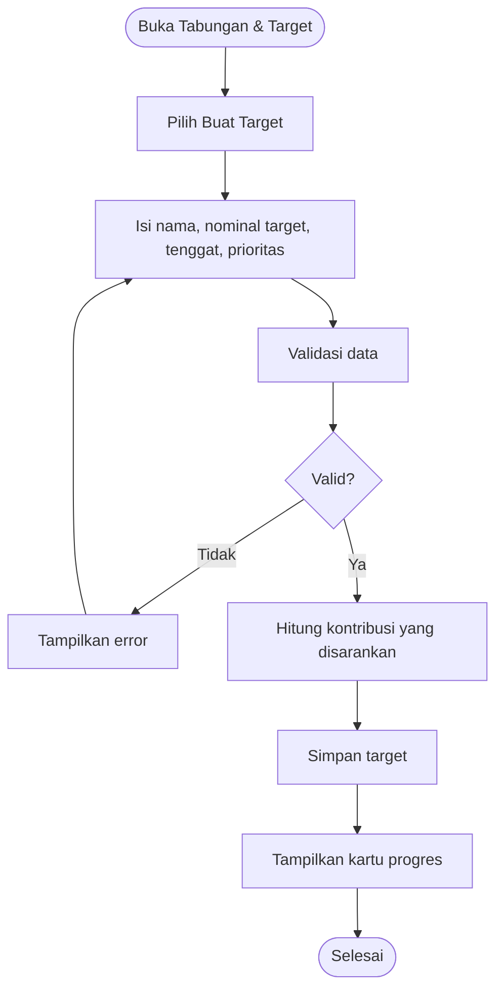

### 8.2 Menambahkan Kontribusi

1. Pengguna membuka target.
2. Memilih Tambah Kontribusi.
3. Mengisi nominal dan tanggal.
4. Memilih apakah kontribusi dikaitkan dengan transaksi/transfer yang sudah ada.
5. Backend memvalidasi agar kontribusi tidak dihitung dua kali.
6. Sistem menyimpan kontribusi.
7. Progres dan estimasi diperbarui.

Aturan penting:
- Target merupakan alokasi/perencanaan, bukan akun uang baru.
- Kontribusi yang berasal dari transfer internal tidak boleh mengurangi total kekayaan dua kali.
- Jika kontribusi hanya berupa pencatatan target tanpa perpindahan uang, UI harus menjelaskan bahwa saldo akun tidak berubah.
- Penarikan mengurangi progres target dan memiliki riwayat.

### 8.3 Estimasi Target

Sistem menghitung:
- Sisa nominal.
- Persentase tercapai.
- Rata-rata kontribusi.
- Kontribusi yang dibutuhkan per periode.
- Estimasi tanggal tercapai berdasarkan asumsi kontribusi.

Estimasi harus diberi label sebagai perkiraan, bukan jaminan.

---

## 9. Alur Budget Planner

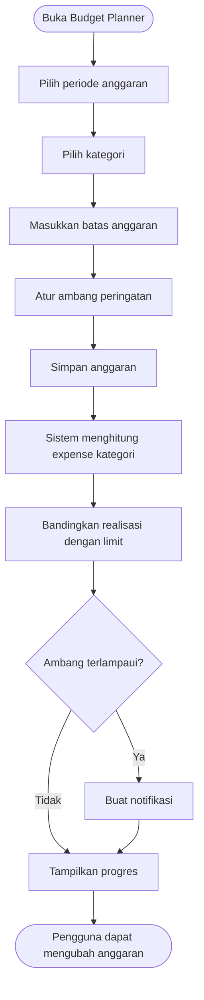

Rumus dasar:
- Terpakai = total pengeluaran yang memenuhi periode, akun, dan kategori.
- Sisa = batas anggaran − terpakai.
- Persentase = terpakai / batas anggaran × 100%.

Ketentuan:
- Transfer internal tidak masuk realisasi pengeluaran.
- Refund mengikuti kebijakan yang konsisten.
- Pengeluaran tanpa kategori dapat ditampilkan dalam kategori “Belum dikategorikan”.
- Perubahan periode dan kategori harus memperbarui perhitungan.

---

## 10. Alur Analisis Keuangan

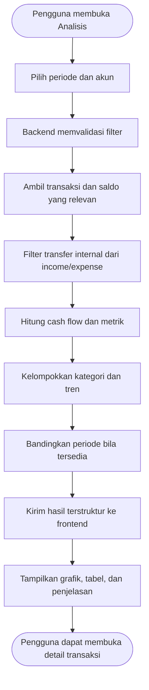

Metrik:
- Total income.
- Total expense.
- Net cash flow.
- Pengeluaran per kategori.
- Perubahan dibanding periode sebelumnya.
- Rata-rata pengeluaran.
- Tren pemasukan.
- Progres tabungan.
- Penggunaan anggaran.

Semua metrik harus dihitung di backend atau lapisan analitik yang teruji, bukan dihitung ulang secara bebas oleh AI.

---

## 11. Alur AI Financial Assistant

### 11.1 Pertanyaan Pengguna

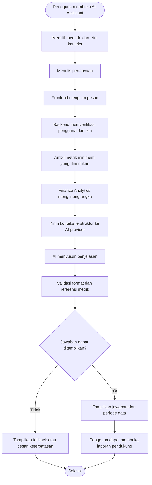

### 11.2 Contoh Pertanyaan

- “Berapa pengeluaran saya bulan ini?”
- “Kategori apa yang paling banyak menghabiskan uang?”
- “Bandingkan pengeluaran bulan ini dengan bulan lalu.”
- “Apakah anggaran makan saya hampir habis?”
- “Berapa yang perlu saya sisihkan setiap bulan untuk mencapai target laptop?”
- “Bantu buat anggaran berdasarkan rata-rata pengeluaran saya.”

### 11.3 Aturan AI

- AI tidak boleh mengakses database secara langsung.
- Backend menentukan data yang boleh digunakan.
- Angka penting dihitung oleh Finance Engine.
- Konteks dikirim dalam bentuk agregat jika cukup.
- Jawaban mencantumkan periode, asumsi, dan keterbatasan.
- Jika data belum cukup, AI meminta klarifikasi atau menyatakan belum dapat menyimpulkan.
- Jangan menyimpulkan pengguna boros atau memberi penilaian moral.
- Jangan menjanjikan hasil investasi.
- Jika provider AI gagal, transaksi dan fitur inti tetap berjalan.
- Riwayat percakapan mengikuti pengaturan privasi pengguna.

---

## 12. Alur Integrasi Bank dan E-Wallet

**Fase:** Lanjutan setelah MVP dan kelayakan penyedia dikonfirmasi.

### 12.1 Menghubungkan Akun

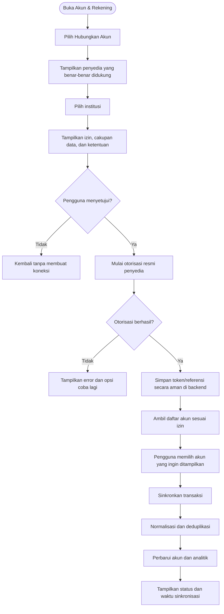

### 12.2 Sinkronisasi Berkala

1. Worker memeriksa jadwal sinkronisasi.
2. Memastikan koneksi masih aktif dan token valid.
3. Meminta transaksi baru sesuai kemampuan provider.
4. Menormalisasi data.
5. Menerapkan idempotency dan deduplikasi.
6. Menyimpan transaksi baru atau perubahan yang didukung.
7. Memperbarui saldo/metadata sesuai sumber.
8. Menyimpan waktu sinkronisasi.
9. Menampilkan status sukses atau gagal.

### 12.3 Memutus Koneksi

1. Pengguna membuka koneksi.
2. Memilih Putuskan Koneksi.
3. Sistem menjelaskan dampaknya.
4. Pengguna mengonfirmasi.
5. Backend mencabut token atau meminta pencabutan pada provider jika didukung.
6. Token lokal dihapus atau dinonaktifkan secara aman.
7. Riwayat transaksi yang sudah tersimpan mengikuti kebijakan retensi dan tidak otomatis dihapus.
8. UI menampilkan status terputus.

### 12.4 Penanganan Error Integrasi

Kasus:
- Token kedaluwarsa.
- Persetujuan dicabut.
- Provider tidak tersedia.
- Rate limit.
- Timeout.
- Format data berubah.
- Transaksi duplikat.
- Sinkronisasi parsial.

Perilaku:
- Jangan menghapus data lama yang valid.
- Tampilkan waktu data terakhir berhasil disinkronkan.
- Sediakan retry dengan batas dan backoff.
- Simpan kode error yang aman tanpa token/rahasia.
- Minta pengguna mengotorisasi ulang bila diperlukan.
- Jangan menyebut saldo sebagai real-time jika sumber tidak mendukungnya.

---

## 13. Alur Laporan dan Ekspor

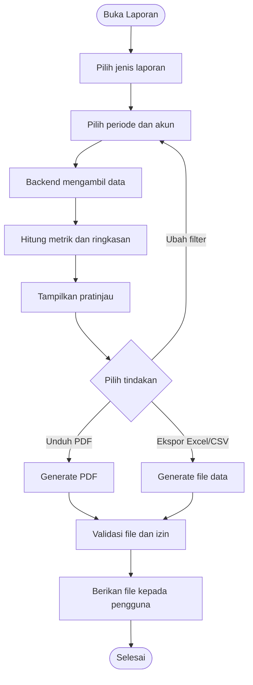

Aturan:
- Laporan mengikuti filter yang terlihat.
- Transfer internal ditampilkan terpisah.
- File hanya dapat diakses pemiliknya.
- File sementara memiliki masa berlaku.
- Format angka dan tanggal konsisten dengan preferensi pengguna.

---

## 14. Alur Notifikasi

Sumber pemicu:
- Perubahan realisasi anggaran.
- Tenggat target tabungan.
- Jadwal tagihan.
- Hasil sinkronisasi.
- Laporan berkala.
- Aturan deteksi transaksi tidak biasa.

Alur:
1. Event atau scheduler menghasilkan pemicu.
2. Notification Service memeriksa preferensi pengguna.
3. Sistem mencegah notifikasi duplikat.
4. Notifikasi disimpan.
5. Kanal pengiriman yang diaktifkan digunakan.
6. Pengguna membuka notifikasi.
7. Sistem mengarahkan pengguna ke halaman terkait.

Notifikasi harus dapat dimatikan per kategori.

---

## 15. Alur Pengaturan Privasi dan Data

### 15.1 Ekspor Data Pengguna

1. Pengguna membuka Settings → Export Data.
2. Memilih data yang ingin diekspor atau memilih semua.
3. Backend memverifikasi sesi.
4. Sistem membuat file ekspor.
5. Pengguna mendapat tautan unduh yang aman dan terbatas waktu.
6. File kedaluwarsa sesuai kebijakan.

### 15.2 Menghapus Akun

1. Pengguna membuka Settings → Delete Account.
2. Sistem menjelaskan dampak penghapusan.
3. Pengguna melakukan verifikasi ulang.
4. Pengguna mengonfirmasi.
5. Sistem menonaktifkan akses.
6. Data dihapus atau dianonimkan sesuai kebijakan dan kewajiban retensi yang berlaku.
7. Koneksi penyedia dicabut jika didukung.
8. Pengguna mendapat konfirmasi proses.

Jangan menjanjikan penghapusan instan dari seluruh backup jika ada siklus retensi teknis atau kewajiban hukum; jelaskan kebijakannya.

---

## 16. System Flow Keseluruhan

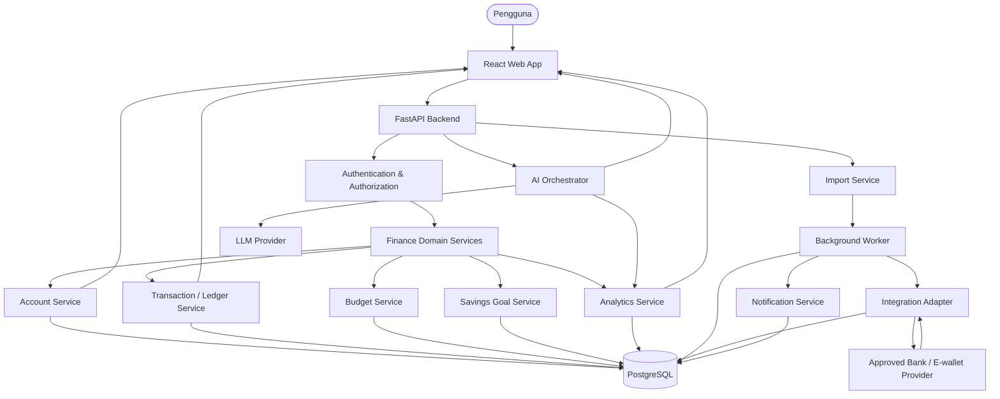

### 16.1 Tanggung Jawab Komponen

**Frontend**
- Menampilkan UI.
- Mengelola form dan state tampilan.
- Mengirim permintaan ke API.
- Menampilkan validasi, status, dan hasil.

**Backend API**
- Autentikasi dan otorisasi.
- Validasi data.
- Menjalankan aturan bisnis.
- Mengontrol akses antarpengguna.

**Finance Domain Services**
- Akun.
- Ledger dan transaksi.
- Transfer.
- Anggaran.
- Target tabungan.
- Perhitungan saldo.

**Analytics Service**
- Menghasilkan metrik yang konsisten.
- Menyediakan agregasi untuk dashboard, laporan, dan AI.

**AI Orchestrator**
- Mengatur konteks dan izin.
- Mengambil metrik dari Analytics Service.
- Menghubungi model AI.
- Memvalidasi dan menyajikan hasil.

**Integration Adapter**
- Menghubungkan provider resmi.
- Menormalisasi format.
- Menangani token, sinkronisasi, dan error provider.

**Background Worker**
- Impor file.
- Sinkronisasi.
- Laporan berat.
- Notifikasi terjadwal.

---

## 17. Aturan Bisnis Lintas Modul

Aturan ini harus diterapkan konsisten di semua halaman dan layanan.

### 17.1 Saldo

Saldo akun dihitung dari:
- Saldo awal.
- Pemasukan ke akun.
- Pengeluaran dari akun.
- Transfer masuk.
- Transfer keluar.
- Penyesuaian yang tercatat.

Secara konseptual:

`Saldo akhir = Saldo awal + pemasukan + transfer masuk - pengeluaran - transfer keluar + penyesuaian`

### 17.2 Cash Flow

`Arus kas bersih = total pemasukan - total pengeluaran`

Transfer internal dikecualikan dari kedua total tersebut.

### 17.3 Total Saldo

Total saldo dashboard merupakan penjumlahan saldo akun aktif yang dipilih pengguna untuk disertakan. Jangan menambahkan target tabungan sekali lagi karena uangnya sudah berada di akun.

### 17.4 Target Tabungan

Target adalah tujuan/alokasi. Target bukan akun tambahan kecuali pengguna memang membuat akun keuangan terpisah untuk menyimpan uang tersebut.

### 17.5 Anggaran

Hanya transaksi pengeluaran yang memenuhi periode dan kategori yang dihitung sebagai realisasi anggaran. Transfer internal tidak dihitung.

### 17.6 Mata Uang

- Setiap akun dan transaksi memiliki mata uang.
- MVP dapat membatasi mata uang ke IDR.
- Jika multi-currency ditambahkan, konversi harus menyimpan kurs, tanggal kurs, dan sumber kurs.
- Jangan menjumlahkan mata uang berbeda tanpa konversi yang transparan.

### 17.7 Sumber Data

Setiap transaksi harus memiliki sumber:
- Manual.
- Import.
- Connected provider.
- System adjustment.

Sumber transaksi harus dapat ditelusuri.

---

## 18. Status dan State UI

Setiap modul perlu mendukung status berikut.

| Status | Perilaku UI |
|---|---|
| Loading | Skeleton atau indikator proses |
| Empty | Penjelasan dan tindakan pertama |
| Success | Data atau konfirmasi hasil |
| Validation error | Pesan dekat field terkait |
| API error | Pesan umum dan opsi coba lagi |
| Permission error | Jelaskan akses yang tidak diizinkan |
| Sync pending | Tampilkan proses sinkronisasi |
| Sync failed | Tampilkan waktu terakhir sukses dan opsi retry |
| Offline | Jelaskan keterbatasan data terbaru |
| Partial data | Tampilkan bagian yang tersedia dan keterbatasannya |

---

## 19. Prioritas Implementasi Flow

### MVP — Harus Dibangun Terlebih Dahulu

1. Registrasi, login, dan onboarding.
2. Akun manual dan saldo awal.
3. Transaksi pemasukan dan pengeluaran.
4. Transfer antar-akun.
5. Ledger dan perhitungan saldo.
6. Dashboard.
7. Kategori transaksi.
8. Target tabungan.
9. Budget planner.
10. Analisis dasar.
11. Pengaturan dan ekspor data dasar.

### Tahap Berikutnya

1. Impor CSV/XLSX.
2. Laporan PDF/Excel.
3. Transaksi berulang.
4. Notifikasi.
5. AI Financial Assistant.
6. Pusat edukasi.

### Tahap Integrasi

1. Evaluasi provider.
2. Persetujuan dan koneksi akun.
3. Sinkronisasi.
4. Deduplikasi.
5. Rekonsiliasi.
6. Penanganan error dan pencabutan koneksi.

### Tahap Lanjutan

1. Aset dan kewajiban.
2. Financial Health Indicator.
3. Pengelolaan keuangan keluarga.
4. PWA dan pengalaman mobile lanjutan.

---

## 20. Acceptance Criteria Flow

### Autentikasi
- [ ] Pengguna dapat daftar, login, logout, dan memulihkan akses.
- [ ] Pengguna yang belum login tidak dapat membuka halaman privat.
- [ ] Pengguna hanya melihat data miliknya.

### Akun dan Transaksi
- [ ] Pengguna dapat membuat akun manual dengan saldo awal.
- [ ] Pemasukan menambah saldo akun.
- [ ] Pengeluaran mengurangi saldo akun.
- [ ] Transfer mengurangi akun sumber dan menambah akun tujuan secara atomik.
- [ ] Transfer tidak masuk laporan pemasukan/pengeluaran.
- [ ] Edit dan hapus transaksi memperbarui saldo dengan benar.

### Tabungan dan Anggaran
- [ ] Pengguna dapat membuat target dan mencatat kontribusi.
- [ ] Kontribusi tidak menggandakan saldo.
- [ ] Anggaran menghitung expense yang memenuhi filter.
- [ ] Peringatan mengikuti ambang yang dipilih.

### Analisis dan AI
- [ ] Grafik dan metrik sesuai dengan transaksi.
- [ ] AI menggunakan metrik backend.
- [ ] AI menyebut periode analisis.
- [ ] AI menyatakan keterbatasan jika data tidak cukup.
- [ ] Kegagalan AI tidak mengganggu fitur inti.

### Impor dan Integrasi
- [ ] Impor memiliki pratinjau dan validasi.
- [ ] Transaksi duplikat dapat dikenali.
- [ ] Integrasi hanya menampilkan provider yang benar-benar didukung.
- [ ] Token tidak pernah dikirim ke frontend atau ditulis ke log.
- [ ] Pengguna dapat memutus koneksi.
- [ ] Kegagalan sinkronisasi tidak menghapus data yang sudah tersimpan.

---

## 21. Panduan untuk AI Coding Agent

Gunakan `PRD.md` sebagai sumber kebutuhan produk dan `FLOW.md` sebagai sumber alur pengguna serta aturan interaksi sistem.

Sebelum implementasi:
1. Periksa repository dan struktur kode yang tersedia.
2. Baca `PRD.md` dan `FLOW.md` secara menyeluruh.
3. Identifikasi perbedaan antara implementasi saat ini dan dokumen.
4. Buat daftar pekerjaan berdasarkan fase.
5. Konfirmasi keputusan yang belum ditentukan, terutama aturan saldo negatif, refund, dan rekonsiliasi.
6. Rancang database dan ledger sebelum mengembangkan transaksi.
7. Buat diagram atau dokumentasi tambahan bila ada alur baru.

Saat implementasi:
- Ikuti urutan MVP.
- Jangan membuat integrasi bank/e-wallet palsu.
- Jangan membuat angka dashboard statis sebagai data produksi.
- Jangan menghitung saldo hanya di frontend.
- Jangan menghitung transfer sebagai income atau expense.
- Gunakan database transaction untuk transfer dan perubahan ledger.
- Gunakan decimal/numeric untuk nominal uang.
- Terapkan isolasi data per pengguna.
- Jangan mengirim kredensial atau token ke frontend.
- Buat test untuk setiap aturan finansial penting.
- Jangan membuat tombol yang tidak memiliki aksi.
- Pertahankan konsistensi navigasi dan state UI.

Setelah implementasi:
1. Uji setiap flow dari awal sampai akhir.
2. Cocokkan implementasi dengan acceptance criteria.
3. Laporkan status: selesai, parsial, belum dibuat, atau bermasalah.
4. Sertakan bukti berupa file, komponen, endpoint, migration, dan hasil test.
5. Dokumentasikan keputusan atau penyimpangan dari PRD/FLOW.
6. Jangan menyatakan fitur selesai hanya karena UI-nya sudah dibuat.

---

**Akhir dokumen FLOW Finora v1.0**

Dokumen ini melengkapi `PRD.md`. Detail visual berada di `DESIGN.md`, keputusan stack di `TECHSTACK.md`, skema rinci di `DATABASE.md`, dan kontrak endpoint di `API.md`.
